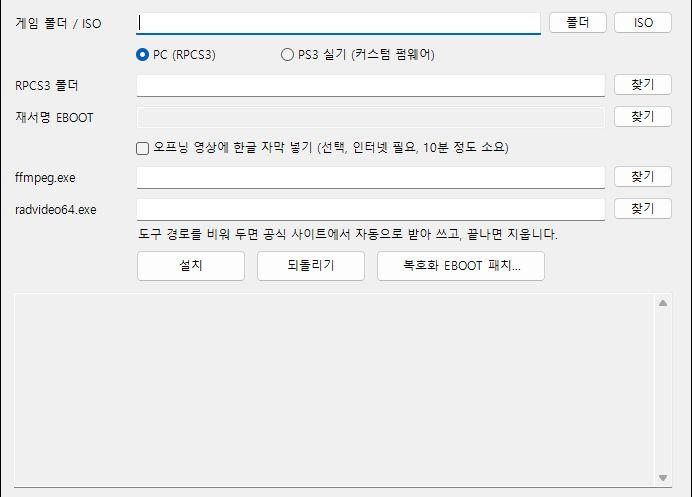

# 클라이브 바커의 제리코 한글패치 (PS3)

PS3 게임 **Clive Barker's Jericho (북미판, BLUS30063)** 를 한글로 즐길 수 있게 해 주는 패처입니다.
PC 에뮬레이터 **RPCS3** 와 **커스텀 펌웨어 PS3 실기** 에서 쓸 수 있습니다.

> **한글화: Yonggary6425**
> 이 패처에는 게임 파일이 들어 있지 않습니다. 게임은 직접 가지고 있는 원본을 사용하세요.

| 항목 | 내용 |
|---|---|
| 대상 | Clive Barker's Jericho (USA) — **BLUS30063** |
| 패치 버전 | **v1.0** |
| 지원 환경 | RPCS3, PS3 실기(커스텀 펌웨어) |
| 적용 방식 | ISO 적용 (원본 옆에 `_KOR.iso` 생성), 폴더형 게임 설치 |
| RPCS3 게임 패치(yml) | 패처가 **자동으로 설치하고 켬** |
| 영상 자막 | 선택 (설치할 때 도구를 받아 쓰고 지움) |
| 패치 용량 | 약 1MB (게임 데이터 미포함) |

> ⚠️ **RPCS3에서 `_KOR.iso`를 실행하면 RPCS3가 꺼진다면**
> 사용 중인 RPCS3가 오래된 버전입니다. 2026년 10월 중순 이전 RPCS3에는 ISO를 직접 실행할 때 생기는 버그가 남아 있습니다.
> RPCS3 메뉴 **도움말 → 업데이트 확인**으로 **최신 버전**으로 올린 뒤 다시 실행하세요. 패치를 다시 할 필요는 없습니다.
> 업데이트가 어렵다면 **폴더 방식**으로 설치해 플레이하세요. 폴더 방식은 RPCS3 버전과 상관없이 정상 동작합니다. ([방법 보기](#iso로-실행하면-rpcs3가-꺼져요))

## 📥 다운로드

오른쪽 **Releases** 에서 `Jericho_PS3_KOR_v1.0.zip` 을 받으세요.
→ [최신 버전 받기](../../releases/latest)

---

## 무엇이 바뀌나요?

- 메뉴, 대사 자막, 설명 글이 한국어로 나옵니다.
- 한글 글꼴은 내 PC에 있는 "맑은 고딕"으로 패처가 직접 만들어 넣습니다.
- (선택) 오프닝 영상에도 한글 자막을 입힐 수 있습니다.
- 로고 영상 다음에 "한글화 by Yonggary6425" 화면이 약 4초 나옵니다.
- RPCS3에서는 글꼴 깨짐 수정과 보너스 코드 패치가 자동으로 적용됩니다.

---

## 준비물

| 준비물 | 설명 |
|---|---|
| Windows 10 또는 11 PC | 패처는 Windows에서만 실행됩니다. |
| 게임 원본 ISO 파일 | 북미판 **BLUS30063** (영어·프랑스어·독일어·스페인어·이탈리아어 판). 다른 판은 안 됩니다. |
| 빈 저장 공간 | ISO가 있는 드라이브에 **약 4GB** (완성된 한글 ISO가 저장될 자리).<br>영상 자막을 넣는다면 C 드라이브에 **약 6GB** 더 (작업 중에만 잠깐 쓰고 끝나면 비워짐, [이유](#자막을-넣을-때-왜-c-드라이브에-6gb나-필요한가요)). |
| RPCS3 (PC로 할 때) | 이미 이 게임을 실행할 수 있게 설정된 RPCS3.<br>**ISO로 실행하려면 최신 버전**이 필요합니다 (2026년 10월 17일 이후 빌드). 폴더 방식은 버전 제한이 없습니다. |

---

## 설치 방법 (PC · RPCS3)



1. **압축 풀기**
   받은 `Jericho_PS3_KOR_v1.0.zip` 을 마우스 오른쪽 버튼으로 누르고 **"압축 풀기"** 또는 **"모두 압축 풀기"** 를 고릅니다.

2. **패처 실행**
   압축을 푼 폴더에서 `JerichoKO_Patcher.exe` 를 더블클릭합니다.
   > 파란 창 **"Windows의 PC 보호"** 가 뜨면 **"추가 정보"** → **"실행"** 을 누르세요.
   > 개인이 만든 프로그램이라 Windows가 처음 보는 파일로 알리는 것입니다.

3. **원본 ISO 고르기**
   맨 위 **"게임 폴더 / ISO"** 줄 오른쪽의 **[ISO]** 버튼을 눌러 원본 게임 ISO 파일을 고릅니다.

4. **"PC (RPCS3)"** 에 점이 찍혀 있는지 확인합니다. (처음부터 선택되어 있습니다.)

5. **RPCS3 폴더 고르기**
   **"RPCS3 폴더"** 줄의 **[찾기]** 를 눌러 `rpcs3.exe` 가 들어 있는 폴더를 고릅니다.

6. **(선택) 오프닝 영상 자막**
   오프닝 영상에도 한글 자막을 원하면 **"오프닝 영상에 한글 자막 넣기"** 에 체크합니다.
   설치를 누르면 필요한 무료 도구를 받을지 묻는 창이 뜹니다. 내용을 읽고 **"예"** 를 누르세요.
   (인터넷 필요, 10분 정도 걸립니다. 받은 도구는 끝나면 자동으로 지워집니다.)

7. **[설치] 누르기**
   아래 글상자에 **"설치가 끝났습니다"** 가 나올 때까지 기다립니다.
   자막 없이 1~2분, 자막을 넣으면 5~10분쯤 걸립니다. 중간에 창을 닫지 마세요.

8. **완성!**
   원본 ISO 옆에 **`원래이름_KOR.iso`** 파일이 새로 생깁니다. 원본 ISO는 그대로입니다.
   RPCS3에서 이 **`_KOR.iso`** 를 실행하세요.
   > ⚠️ 실행하자마자 RPCS3가 꺼지면 RPCS3를 **최신 버전으로 업데이트**하거나 **폴더 방식**으로 설치하세요. ([자세히](#iso로-실행하면-rpcs3가-꺼져요))

> 💡 글상자에 "RPCS3의 관리 > 게임 패치에서 켜 주세요" 라는 말이 보이면,
> RPCS3 메뉴의 **관리 → 게임 패치** 에서 이 게임의 **"Korean font fixes"** 와 **"Bonus codes"** 에 체크해 주세요.

---

## 게임 안에서 자막 켜기

자막은 처음에 꺼져 있습니다.
게임 메뉴 **구성 설정 → 게임 옵션 → 자막 보기** 를 켜고, 화면 아래 **"수락"** 으로 저장하세요.

---

## PS3 실기 (커스텀 펌웨어)

1. 패처에서 원본 ISO를 고르고 **"PS3 실기 (커스텀 펌웨어)"** 를 선택한 뒤 **[설치]** 를 누릅니다.
2. 만들어진 `_KOR.iso` 를 PS3로 옮겨(USB 또는 FTP로 `PS3ISO` 폴더에) **webMAN** 등으로 실행합니다.

- 한글 글자, 글꼴, 자막 영상은 그대로 적용됩니다.
- 다만 **선택된 메뉴 글자가 뭉개지는 문제 수정**과 **보너스 코드**는 게임 실행 파일(EBOOT) 수정이 필요합니다.
  이 부분은 직접 복호화·재서명을 할 줄 아는 분만 아래 "고급" 항목을 참고하세요.
- ⚠️ PS3 실기에서는 제작자가 직접 시험해 보지 못했습니다.

<details>
<summary><b>고급: 실기에서 글꼴 수정·보너스 코드까지 넣기</b></summary>

1. 원본 `EBOOT.BIN` 을 RPCS3 메뉴 **Utilities → Decrypt PS3 Binaries** 등으로 ELF 파일로 복호화합니다.
2. 패처의 **[복호화 EBOOT 패치...]** 버튼으로 그 ELF 파일을 고칩니다. (`_KO_patched.elf` 가 생깁니다.)
3. 고친 파일을 재서명 도구로 `EBOOT.BIN`(SELF)으로 바꿉니다. **패처는 복호화와 재서명을 하지 않습니다.**
4. 패처에서 **"PS3 실기"** 를 고르고 **"재서명 EBOOT"** 칸에 3번 파일을 지정한 뒤, 원본 ISO로 설치합니다.

재서명하지 않은 ELF를 넣으면 패처가 거부합니다. 게임이 켜지지 않으면 이 칸을 비우고 다시 설치하세요.
</details>

---

## 보너스 코드

RPCS3(또는 고친 EBOOT)에서 보너스 코드 화면에 **숫자 1~9 중 하나**를 넣으면 해당 항목이 풀립니다.

| 숫자 | 해금 | 숫자 | 해금 |
|---|---|---|---|
| 1 | 도미네이터 대미지 | 6 | 강력한 근접 공격 |
| 2 | 엑스트라 해금 | 7 | 무한 아바비닐리 |
| 3 | 무제한 탄약 | 8 | 무한 콜 능력 |
| 4 | 생존 이벤트 자동 성공 | 9 | 모든 레벨 해금 |
| 5 | 빠른 체력 회복 | | |

---

## 자주 묻는 질문

#### ISO로 실행하면 RPCS3가 꺼져요
패치는 정상적으로 끝났는데 `_KOR.iso`를 실행하면 RPCS3까지 꺼지는 경우입니다. 같은 패치를 폴더 방식으로 하면 잘 됩니다.

**원인:** RPCS3가 ISO 직접 실행을 지원한 지 오래되지 않아, 2026년 10월 중순 이전 버전에는 ISO 안의 파일을 읽을 때 RPCS3가 통째로 꺼지는 버그가 있었습니다.
한글 ISO에는 원본에 없는 `mods` 폴더가 추가되어 이 버그에 걸릴 수 있습니다. (예: `0.0.42-20031` 버전에서 확인)

**해결 방법 1 — RPCS3 업데이트 (권장)**
1. RPCS3 메뉴 **도움말(Help) → 업데이트 확인(Check for Updates)** 을 누릅니다.
2. 최신 버전으로 업데이트한 뒤, 이미 만든 `_KOR.iso`를 그대로 다시 실행합니다. 패치를 다시 할 필요는 없습니다.
3. 창 제목의 버전이 **0.0.43 이상**이고 2026년 10월 17일 이후 빌드인지 확인하세요.

**해결 방법 2 — 폴더 방식으로 설치**
1. 원본 ISO를 압축 프로그램(7-Zip 등)으로 풀거나, Windows에서 ISO를 더블클릭해 연 뒤 내용을 새 폴더에 복사합니다. (`PS3_GAME` 폴더가 들어 있어야 합니다)
2. 패처에서 **[ISO]** 대신 **[폴더]** 버튼으로 그 폴더를 고르고 **[설치]** 를 누릅니다.
3. RPCS3에서 **파일 → 게임 추가** 로 그 폴더를 추가하거나, `PS3_GAME\USRDIR\EBOOT.BIN` 을 열어 실행합니다.

업데이트한 뒤에도 꺼지면 RPCS3 폴더의 `RPCS3.log` 파일을 첨부해 [Issues](../../issues)에 알려 주세요.

**Q. "이미 한글 패치가 적용된 ISO입니다" 라고 나와요.**
A. 이미 한글화된 ISO에는 다시 패치할 수 없습니다. **원본 ISO** 를 골라 주세요.

**Q. "지원하는 원본이 아니거나 이미 수정된 파일입니다" 라고 나와요.**
A. 북미판(BLUS30063)이 아니거나, 다른 방법으로 이미 고친 게임입니다. 수정하지 않은 원본을 사용하세요.

**Q. "저장 공간이 부족합니다" 라고 나와요.**
A. ISO가 있는 드라이브에 약 4GB 이상 빈 공간을 만든 뒤 다시 해 보세요.

#### 자막을 넣을 때 왜 C 드라이브에 6GB나 필요한가요?
자막 작업은 ISO가 있는 곳이 아니라 **Windows 임시 폴더**에서 합니다.
임시 폴더는 보통 C 드라이브(`C:\Users\사용자이름\AppData\Local\Temp`)에 있습니다.

1. 패처는 영상을 장면 하나하나 그림 파일로 풀어 그 위에 한글 자막을 그립니다.
2. 프롤로그 영상은 약 3,900장면이고 그림 한 장이 1MB가 넘어, 잠깐 5GB 넘게 차지합니다.
3. 여기에 꺼낸 원본 영상, 새로 만든 영상, 받은 도구가 더해져 넉넉히 약 6GB입니다.

영상은 하나씩 처리하고 끝날 때마다 지우므로, **설치가 끝나면 이 공간은 다시 비워집니다.**
ISO 드라이브의 약 4GB는 완성된 `_KOR.iso`(약 3.6GB)가 남을 자리라 별개입니다.

**Q. 압축을 푼 게임 폴더(PS3_GAME 폴더)로도 되나요?**
A. 됩니다. **[ISO]** 대신 **[폴더]** 버튼으로 `PS3_GAME` 이 들어 있는 폴더를 고르세요.
폴더 방식은 게임 파일을 직접 고치므로, 먼저 폴더를 **백업**해 두는 것이 좋습니다.

**Q. 원래대로 되돌리고 싶어요.**
A. ISO로 설치했다면 만들어진 `_KOR.iso` 파일만 지우면 됩니다.
폴더로 설치했다면 같은 폴더를 고르고 **[되돌리기]** 를 누르세요.

**Q. 자막 넣기에 쓰는 도구는 뭔가요?**
A. 영상 편집 도구 **ffmpeg**(gyan.dev)와 **RAD Video Tools**(radgametools.com)입니다.
패처에는 들어 있지 않고, 설치할 때 공식 사이트에서 받아 쓴 뒤 지웁니다.
PC에 이미 있다면 패처가 자동으로 찾아 쓰고, 칸에 직접 위치를 지정할 수도 있습니다.
RAD Video Tools는 재배포·상업적 사용이 금지된 무료 도구입니다.

---

## 개발자용: 직접 빌드하기

Windows에 기본으로 들어 있는 .NET Framework 4 컴파일러로 빌드합니다. 별도 설치가 필요 없습니다.

```bat
build.bat
```

결과물: `build\JerichoKO_Patcher.exe`

| 파일 | 내용 |
|---|---|
| `src/JerichoKoPatcher.cs` | 패처 소스 (C#, Windows Forms) |
| `src/ko.tsv.gz` | 한국어 번역문 |
| `src/intro_ko.ass`, `src/prologue_ko.ass` | 영상 자막 |
| `src/splash.bik.gz` | 제작자 화면 영상 |

---

## 알림

- 비공식 팬 번역이며 Codemasters, MercurySteam 등 권리자와 관계가 없습니다.
- 게임 데이터는 배포하지 않습니다. 권리자의 요청이 있으면 배포를 중단합니다.
- 패처 소스 코드는 MIT 라이선스입니다([LICENSE](LICENSE)). 번역문과 자막은 비상업 팬 번역입니다.
